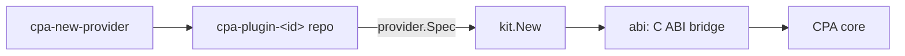

# cpa-provider-kit

A kit for building provider plugins for [CLIProxyAPI](https://github.com/router-for-me/CLIProxyAPI) (CPA) and EasyCLIProxyAPI. You describe a provider in one Go struct (`kit.Spec`). The kit takes care of everything CPA expects from a native plugin:

- the C ABI bridge and RPC dispatch
- auth files and a browser sign-in page for API keys
- the model catalog and the `base-url` / `extra-models` settings
- passthrough execution and SSE streaming
- error-to-status mapping, so CPA's cooldowns work
- quota and plugin-store packaging



## New provider in one command

From a checkout of this repo (until it's published):

```bash
go run ./cmd/cpa-new-provider \
  -id minimax -name MiniMax -owner 404jul \
  -base-url https://api.minimax.io \
  -chat /v1/chat/completions -anthropic /anthropic/v1/messages \
  -models MiniMax-M2 \
  -key-url https://platform.minimax.io/user-center/basic-information/interface-key \
  -validate /v1/models \
  -kit-dir . -out ../cpa-plugin-minimax

cd ../cpa-plugin-minimax && make test && make build && make install
```

Replace the base URL, paths, models and key URL above with the provider's documented values.

The generated repo looks like this:

| File | Purpose |
| --- | --- |
| `internal/provider/provider.go` | The `Spec`: the only file most providers need to edit |
| `internal/provider/provider_test.go` | Checks the spec is valid and that each protocol reaches its endpoint |
| `main.go` | Registers the spec with `abi`; no edits needed |
| `Makefile` | `test`, `build`, `install` (into EasyCLIProxyAPI), and `package` (store zip + `checksums.txt`) |
| `.github/workflows/release.yml` | On a `v*` tag, builds Linux, macOS and Windows libraries and publishes a store-ready release |
| `README.md`, `LICENSE`, `.gitignore` | Repo basics |

Flags:

| Flag | Meaning |
| --- | --- |
| `-chat`, `-anthropic`, `-responses` | Upstream paths for each protocol; give at least one |
| `-count-tokens` | Anthropic `count_tokens` path |
| `-validate` | GET path used to check a key during sign-in |
| `-kit-dir` | Adds a `go.mod` replace pointing at a local kit checkout |
| `-kit-version` | The kit version to require |

Run with `-h` for the full list.

## What a Spec covers

| Need | Use |
| --- | --- |
| API-key provider | `Auth: &kit.APIKeyAuth{KeyURL, Hint, Validate}` |
| Provider speaks OpenAI Chat, Anthropic Messages and/or OpenAI Responses | `Executor: &kit.Passthrough{Endpoints: …}` (see below for optional hooks) |
| Business error codes (e.g. `1308` = quota) | `Errors: kit.ErrorPolicy{CodeStatus: …}` |
| Plan or usage view in the app | `Quota: func(ctx, cred) (pluginapi.QuotaFetchResponse, error)` |
| Live model list per account | `ListModels: func(ctx, cred) ([]kit.Model, error)`; falls back to `Models` on error |
| Provider-specific settings | `ConfigFields` plus `ctx.Config.Decode(&yourStruct)` |
| Validated thinking levels | `kit.Model{Thinking: &pluginapi.ThinkingSupport{…}}`; with `nil`, client settings pass through unchanged |
| OAuth or device-code sign-in (e.g. Kiro, Kilo) | Implement `kit.AuthHandler`: `Describe`, `StartLogin`, `PollLogin`, `Refresh` |
| Custom wire protocol | Implement `kit.Executor` |
| Extra browser pages | `Resources: []kit.ResourceHandler` |

`Passthrough` hooks:

- `Token`: send an OAuth access token instead of the API key.
- `Headers`: add provider-specific headers to every upstream request.
- `Body`: rewrite the payload before it's sent.

Building blocks for custom executors:

- `ctx.Do` / `ctx.DoStream`: call upstream through CPA's transport, so its proxy settings and request logs apply.
- `kit.OpenSSE`: open an SSE upstream request and shape its events for the client protocol.
- `kit.SSESplitter`, `kit.SSEFields`, `kit.SSEFrame`: lower-level SSE parsing and framing.
- `kit.PrepareBody`: set the model and stream flag in a payload.
- `kit.Fail`: return an error that carries an HTTP status.
- `ErrorPolicy.UpstreamFailure`: turn an upstream error response into one.

Streams must emit bare JSON for each chunk for Chat Completions. For Anthropic and Responses they must emit full SSE frames. `Passthrough` and `OpenSSE` already do this.

## Testing

`kit/kittest` drives a plugin through CPA's real RPC methods using a scripted host, with no CPA process needed:

```go
host := &kittest.Host{Do: func(req pluginapi.HTTPRequest) pluginapi.HTTPResponse { … }}
plugin := kit.New(provider.Spec("0.0.0"), host)
kittest.Register(t, plugin, "base-url: http://127.0.0.1:9\n")
kittest.MustCall(t, plugin, pluginabi.MethodExecutorExecute, kittest.Exec(kit.FormatChat, "m", `{}`, authFile), &out)
```

Use `kittest.SSE(body, chunkSize)` to script a streaming response.

## Compatibility

- Built against CPA SDK v8.0.47 (plugin schema 8). Build plugins with Go 1.26.10, the release that CPA build uses; generated Makefiles pin it through `GOTOOLCHAIN`.
- The CPA core has to run natively. On Apple Silicon, the Intel (Rosetta) build of EasyCLIProxyAPI crashes when it loads any Go plugin.
- The sign-in page is served by CPA on its own port, so it works when CPA runs locally. For a remote CPA, upload an auth file instead: `{"type":"<id>","api_key":"…"}`.

## Layout

| Path | Contents |
| --- | --- |
| `kit/` | Spec, plugin dispatch, API-key auth, passthrough, SSE, errors |
| `kit/kittest/` | Fake host and RPC test helpers |
| `abi/` | C ABI exports (`cliproxy_plugin_init`) and host callbacks |
| `cmd/cpa-new-provider/` | Repo generator; templates live in `template/` |
| `cmd/cpa-package/` | Builds plugin-store zips and `checksums.txt` |

## Publishing the kit

Push this repo to `github.com/404jul/cpa-provider-kit` and tag `v0.1.0`. After that, generated repos can drop their `replace` line, which their CI needs anyway because it can't see a local checkout.
